# Полный отчёт с фигурами: ассимиляция SIC, калибровка, сравнение с 3D-Var

Дата: 2026-09-18 13:10. Дополняет `claude_monthly_report_ru.md` (текст) и
`claude_undertrained_or_overfit_ru.md` (доказательства). Все фигуры — в
`docs/research/figures/`.

## 1. Главный вывод

Ансамбль ассимиляции (`balanced_50m`, learned full condition) **в нормальных
условиях (native-two-field) почти калиброван по разбросу**: spread/RMSE .90,
pooled rank-TV .044 при null идеального ансамбля .034. «Недодисперсия .72»,
которую агент месяц пытался лечить, — артефакт протокола сравнения с 3D-Var
(обнуление sithic): та же модель, те же 40 дат, RMSE .190 → .156, rank-TV
.356 → .044. Реальные дефекты — структурные (нет точных нулей, наблюдения
дня d не соблюдаются, отпечаток треков) — закрываются OOF-слоем: fair CRPS
−29 % на 40/40 held-out дат, нули = truth, ранги на уровне null.

## 2. Rank-гистограммы (dev-2022, 40 дат, рандомизированные ранги, M=10)

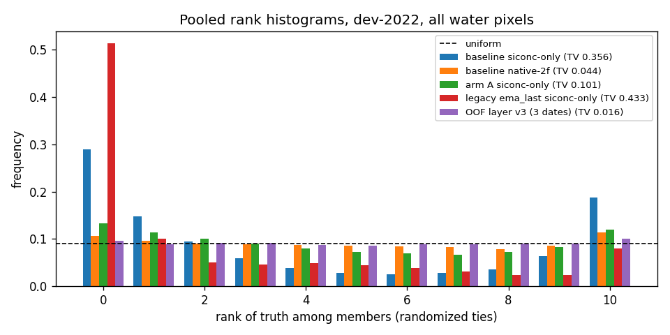

| ансамбль | дат | pooled TV | ≤2 px | 3–10 px | 11–40 px | >40 px |
|---|---|---|---|---|---|---|
| baseline siconc-only | 40 | 0.356 | 0.466 | 0.365 | 0.262 | 0.397 |
| baseline native-2f | 40 | 0.044 | 0.033 | 0.041 | 0.058 | 0.252 |
| arm A siconc-only | 40 | 0.101 | 0.151 | 0.100 | 0.120 | 0.206 |
| legacy ema_last siconc-only | 40 | 0.433 | 0.529 | 0.459 | 0.388 | 0.486 |
| OOF layer v3 (3 dates) | 3 | 0.016 | 0.043 | 0.017 | 0.060 | 0.383 |

Null для идеального обменного ансамбля (M=10): pooled TV .034 (q95 .083).

По стратумам расстояния до трека:

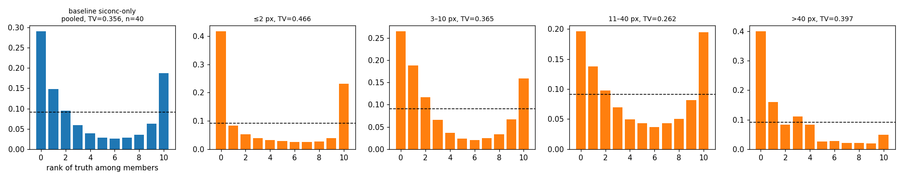
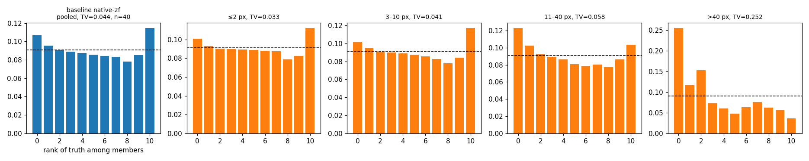
.png)
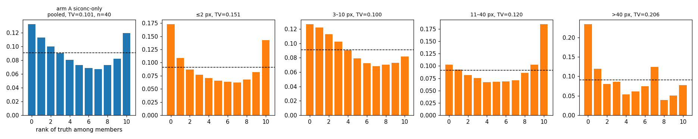
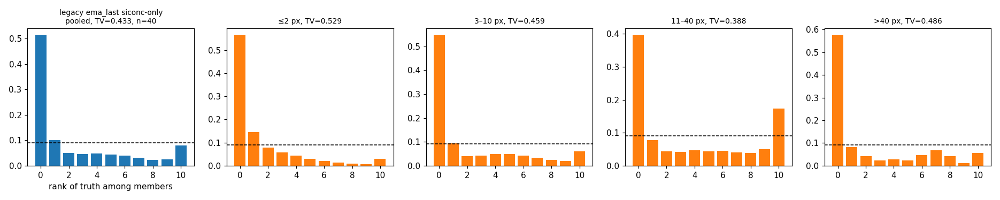

Чтение: siconc-only — истина систематически на краях у трека; native — почти
плоско; слой v3 — плоско везде (3 даты с сохранёнными членами); legacy
`ema_last` (переобученный) — U-форма, разброс слишком мал.

## 3. Кривые обучения / коллапса

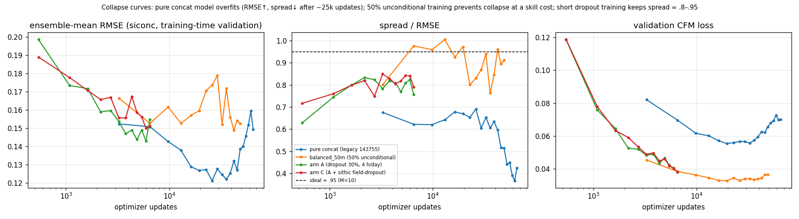

Чистая concat-модель: val_loss растёт после ~20k updates, RMSE .121 → .149,
spread/RMSE .68 → .43 — переобучение (все прошлые оценки брали её худший
checkpoint). `balanced_50m` (50 % шагов без условия): коллапса нет, s/r
.8–1.0, но RMSE на ~25 % хуже. Arm A/C (dropout 30 %, 4 часовых среза,
6.5k updates, ранняя остановка по fair CRPS): RMSE .12–.13, s/r .84–.95 на
training-метрике.

## 4. Слой OOF v3 по стратумам расстояния до трека (held-out)

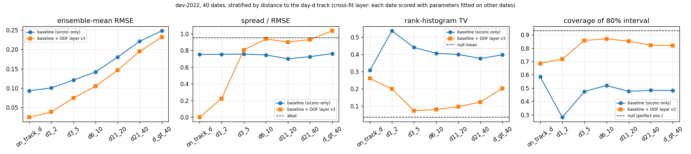

Cross-fit 5×8 дат: fair CRPS .0585 → .0417 (−29 %, CI95 [−.0198, −.0139],
40/40 дат), RMSE .190 → .158, s/RMSE .93, rank-TV .099, cov80 .82–.87 (null
.83–.98), нули .53 (truth .54), cap .106 (truth .060, +.04 — единственный
хвост), на треке дня d RMSE .025 (raw .093).

## 4a. Reliability атомов (dev-2022, 40 дат, все пиксели, без стратификации по истине)

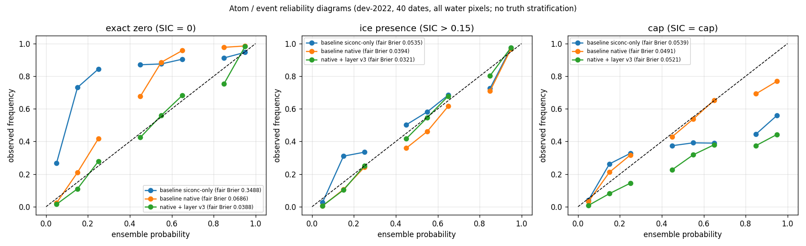

| событие | baseline siconc-only | baseline native | native + слой v3 |
|---|---|---|---|
| exact zero, fair Brier | .349 | .069 | **.039** (на диагонали) |
| лёд > .15, fair Brier | .054 | .039 | **.032** |
| cap, fair Brier | .054 | **.049** (на диагонали) | .052 (переоценка cap) |

Вывод: атом нуля чинит слой; атом cap у native-генератора уже калиброван, и
слой его слегка портит — в v4 cap-вероятность брать у генератора, слоем
исправлять только нулевую сторону.

## 4b. Эволюция слоя за 18.09 (native-two-field, dev-2022 OOS, cross-fit 5×8; 2019 — стресс-тест на train-году)

Полная хроника с мотивацией каждого шага — `claude_autoresearch_analysis_ru.md` §11–12.

| версия | что изменено | dev-2022 CRPS (дат ↑ из 40) | RMSE | s/r | pooled rank-TV | 2019 CRPS |
|---|---|---|---|---|---|---|
| raw `balanced_50m` | — | .0415 | .1562 | .90 | .043 | .0524 |
| v3 | латент с атомами, kriging по треку, OOF-маргиналы по ячейкам, гауссова копула | .0353 (33) | .1397 | .91 | — | .0364 (25) |
| v4 | + бин cap-вероятности генератора | .0353 | = | = | — | — |
| v5 | + OOF-порог cap (масса .095 → .055) | .0354 | = | = | ранги хуже | — |
| v6 | taper только на треке дня d | .0354 (32) | .1401 | .92 | — | — |
| v7 | + режимная ось s_d в ячейках | .0363 (30) | — | — | — | .0366 |
| v8/v9/v10 | nugget в kriging: глобальный / per-date LOO / per-date block-CV; точные треки дня d | .0352 (34) | .1399 | .92 | **.008** | .0363 |
| v11 | копула генератора (ранг-отображение аномалий) | .0353 (37) | .1365 | .99 | .050 | .0393 |
| v12 | стандартизованный паттерн генератора | .0340 (40)* | .1358 | 1.11 | .056 | .0359 |
| v13 | смесь копул: √.5·паттерн + √.5·стационарное поле | .0340 (38) | .1372 | .99 | .016 | .0354 |
| **v15** | **v13, стационарное поле только на длинном масштабе (нет зернистости: спектр высоких k 1.46 → 1.14)** | **.0340 (38)** | **.1371** | **.99** | **.015** | — |

\* v12 — члены не обменяемы (симметричны вокруг среднего без выборочной
изменчивости): U-образные ранги при s/r 1.1; fair CRPS переоценивает.

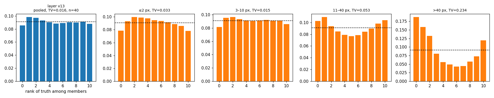

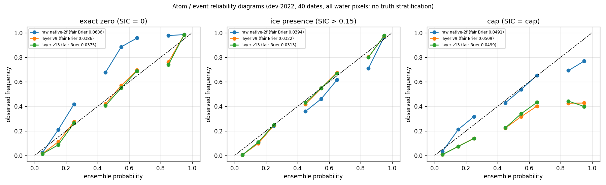

v13 на OOS: Brier нуля .069 → .038, presence .039 → .031, cap .049 → .050;
cov80 .81–.91; pooled rank-TV .016 при null-допуске .034. Открытое: масса cap
.095 vs .060 (cap-атом не различается ни одним вариантом — уровень
квантования M2M), и 14 зимних дат train-2019, где слой проигрывает raw
(генератор там in-sample и точен; сдвиг закона остатка, выученный на
весенне-летних датах, зимой неверен — лечится слоем на нескольких годах).

**Три отрицательных результата про величину разброса** (§11 analysis-doc):
ковариата невязки дня d не нужна (ρ с ошибкой слоя −.06); пер-датный масштаб
разброса даже оракульный даёт −0.2 % CRPS; cap-бин генератора — 0.

### 4c. Члены v13 (11 апреля 2022): raw vs слой

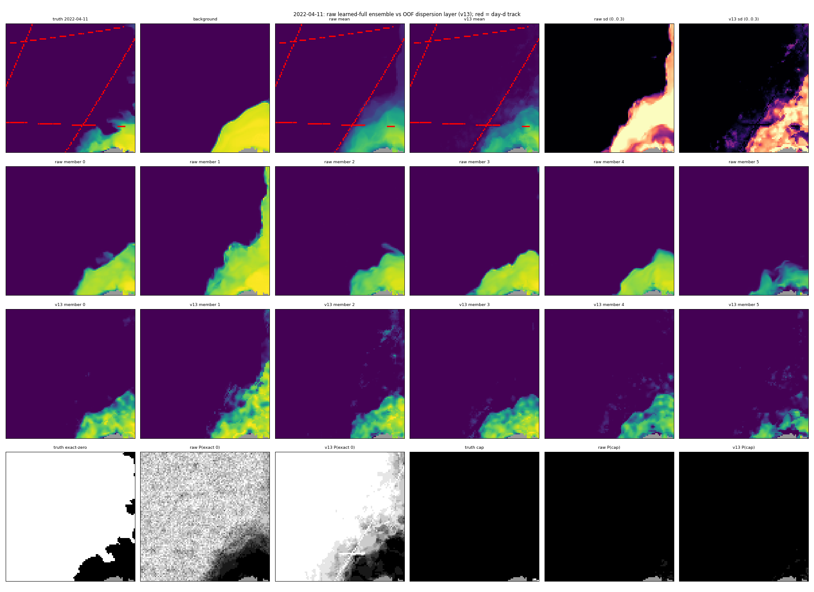

## 5. Члены ансамбля: до и после

Baseline, зима (трек в открытой воде) и весна (сплошной лёд): полосы по
геометрии треков, «дыры» в паке, нет точных нулей.

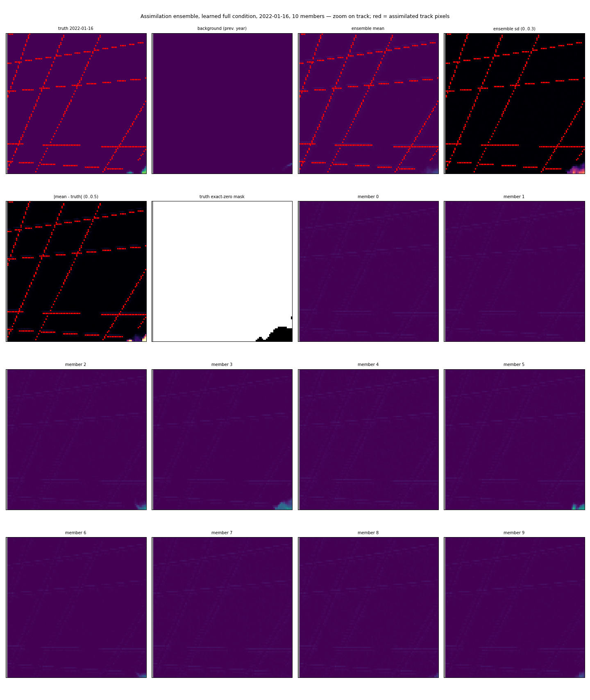
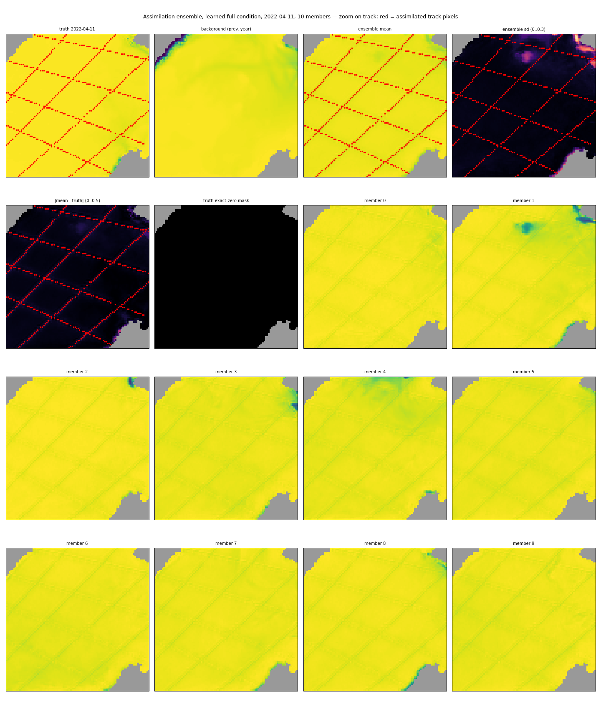

Raw vs слой (внизу карты P(exact 0) и P(cap)): у raw шум с полосами треков,
у слоя — связная вода как в истине, отпечатка нет.

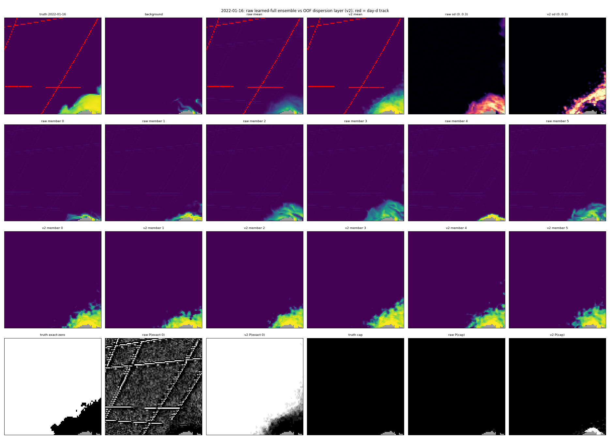
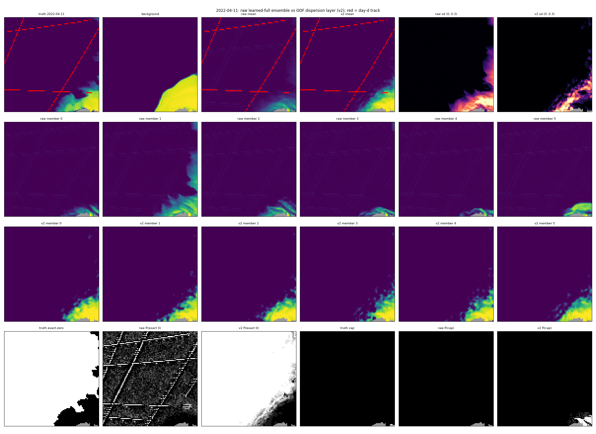

## 6. Сравнение с 3D-Var (test-2023, 200 дней, протокол коллег)

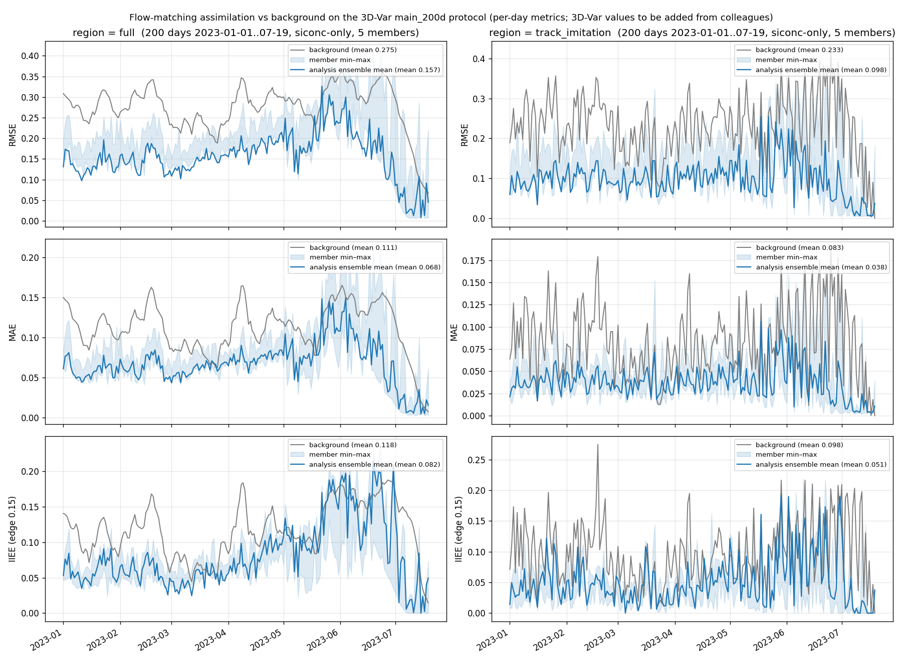
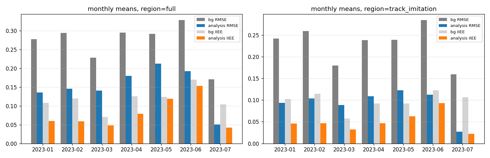

| регион | фон RMSE | анализ RMSE (M=5) | ≈M→∞ | MAE фон→анализ | IIEE фон→анализ | CRPS | spread |
|---|---:|---:|---:|---|---|---:|---:|
| full (48 637 px) | .2748 | **.1569** | .1444 | .1114 → .0678 | .1179 → .0821 | .0481 | .1280 |
| track_imitation (613 px/день) | .2327 | **.0977** | .0863 | .0828 → .0376 | .0977 → .0514 | .0239 | .0928 |

Конфигурация: коммит b539875, `ema_last`, `full`, siconc-only, dopri5/25,
seed 1234, 5 членов; полный список столбцов и протокол — Часть IV
`claude_monthly_report_ru.md`. Строки 3D-Var добавить из данных коллег
(сверить `background_rmse`). В этом протоколе наша модель работает в
OOD-режиме (sithic скрыт); честнее для неё — arm C (обучен под протокол,
оценка в очереди) или native-two-field, если коллеги согласны.

## 7. Прогнозная линия (второстепенно)

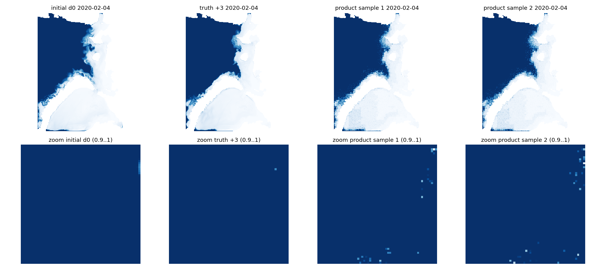

CPU-фальсификатор face-aware каскада: условно-независимые грани при истинных
родителях дают зерно 5–7× truth — то же, что у baseline base32. Каскад —
HOLD/NO-GO; подробности `claude_face_aware_cascade_review.md`.

## 8. Что дальше

Слой заморожен: **v15** (v13 без мелкомасштабной компоненты поля). GPU-очередь (одна GPU, последовательно): arm A
native (идёт) → legacy last/best native → arm C strict; по ним — выбор
генератора под слоем. Затем один вероятностный прогон на test-2023 (v13:
fit на всех 40 датах dev-2022 → apply к 200×5 сохранённым ансамблям), статья.
